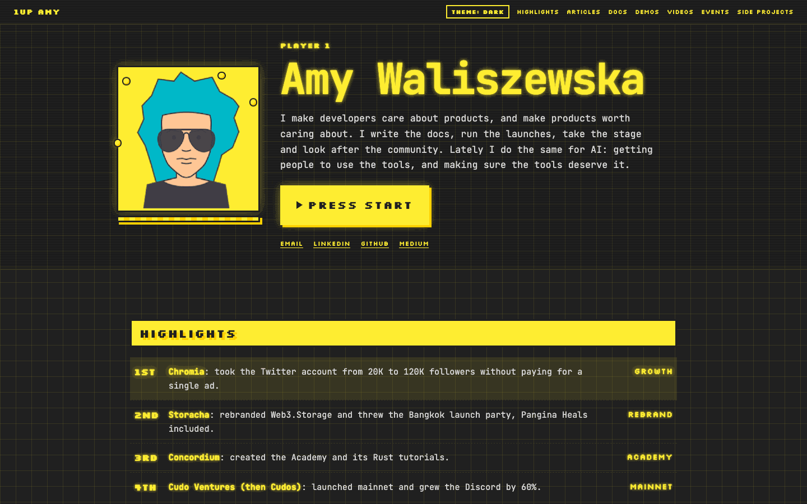
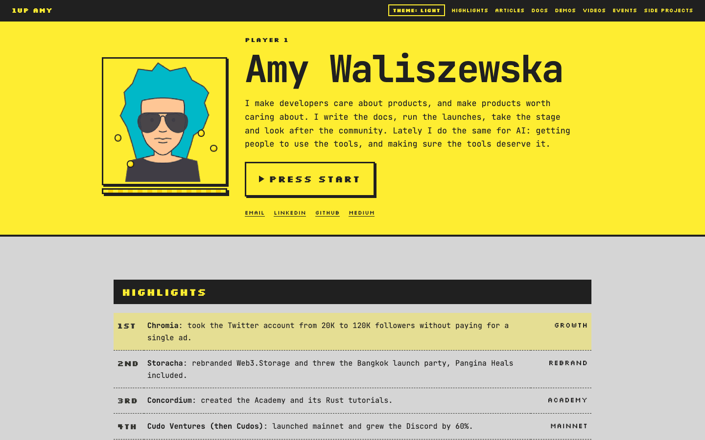

# [Portfolio](https://hakierka.github.io)

Live site: [hakierka.github.io](https://hakierka.github.io)

| Dark | Light |
| --- | --- |
|  |  |

## What it is

A single-page portfolio with an arcade look. It lists articles, docs, demos, videos and events. One HTML file, no build step.

## Features

- **Dark and light theme:** follows the system setting automatically. A toggle remembers your choice in `localStorage`. Without JavaScript, the system theme still applies through CSS.
- **Arcade design:** Dust Grey, Bright Lemon, Gold, Carbon Black and Graphite. JetBrains Mono and Silkscreen, self-hosted.
- **Accessible:** skip link, visible focus, keyboard navigation, WCAG AA contrast checked, `prefers-reduced-motion` respected, readable at 360px wide.
- **Fast and private:** one HTML file, no build, no framework, no external requests, no tracking. About 144 KB with fonts and the avatar.

## Run locally

```bash
git clone https://github.com/hakierka/hakierka.github.io.git
cd hakierka.github.io
python3 -m http.server 8000
```

Open [http://localhost:8000](http://localhost:8000).

Or: `npx serve`.

Opening `index.html` from disk also works.

## Project structure

```
index.html
avatar.png
fonts/
docs/
```

## Palette

| Name | Hex | Where used |
| --- | --- | --- |
| Dust Grey | `#d6d6d6` | Light background; body text in dark mode |
| Bright Lemon | `#ffee32` | Headings and links in dark mode; buttons; accents |
| Gold | `#ffd100` | Hard shadows and button glow in dark mode |
| Carbon Black | `#202020` | Dark background; body text in light mode; HUD bar |
| Graphite | `#333533` | Panels and borders; muted text in light mode |

## Credits and license

- Fonts (JetBrains Mono, Silkscreen): [SIL Open Font License 1.1](fonts/OFL.txt)
- Code: MIT
- Text, photos and avatar: all rights reserved
